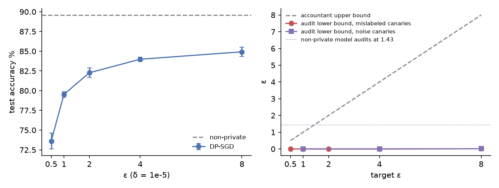
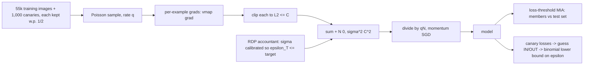

# dpaudit

DP-SGD written from scratch with a Rényi-DP accountant that matches Opacus to 1e-8. It measures privacy–utility curves, and it audits the trained models empirically with membership inference and one-training-run canary audits, comparing the provable upper bound on ε with what an attacker can demonstrate.

[](https://github.com/eshaan2418/dpaudit/actions/workflows/ci.yml)
[](LICENSE)


## Headline result

Fashion-MNIST, a tanh CNN with 26k parameters, 10 epochs, δ = 1e-5. Values are mean ± 95% CI over 3 seeds.

| ε (accountant upper bound) | σ | test accuracy | loss-threshold MIA AUC | audited ε lower bound (1,000 canaries, one run) |
|---|---|---|---|---|
| 0.5 | 1.84 | 73.6 ± 1.0% | 0.507 ± 0.005 | 0.00 |
| 1 | 1.18 | 79.5 ± 0.3% | 0.505 ± 0.003 | 0.00 |
| 2 | 0.87 | 82.3 ± 0.6% | 0.506 ± 0.003 | 0.00 |
| 4 | 0.69 | 84.0 ± 0.2% | 0.507 ± 0.003 | 0.00 |
| 8 | 0.56 | 84.9 ± 0.6% | 0.507 ± 0.004 | 0.01 |
| ∞ (no DP) | - | 89.6 ± 0.2% | 0.513 ± 0.002 | **0.50** (mislabeled canaries) / **1.43** (noise canaries) |

Going from no privacy to ε = 8 costs 4.7 accuracy points, and ε = 1 costs 10.1. The black-box audit clearly detects memorisation in the non-private model: noise-image canaries certify ε ≥ 1.43 at 95% confidence. Against every DP-SGD model it demonstrates essentially nothing (ε ≥ 0.01 at best). That is consistent with the guarantee, and it shows how loose black-box, single-run audits are next to the accountant's worst-case bound.



## Demo

```
$ dpaudit sigma --eps 2 --q 0.004695 --steps 2129
noise multiplier sigma = 0.8710 for epsilon <= 2
$ dpaudit epsilon --q 0.004695 --sigma 0.871 --steps 2129
epsilon = 1.9976 at delta = 1e-05 (best RDP order 7)
$ dpaudit lower-bound --guesses 200 --correct 174
174/200 correct -> epsilon >= 1.432 with confidence 95%
```

(The last line is the non-private model's audit: 174 of 200 confident guesses about which noise canaries were in its training set were right.)

## Why this exists

Differential privacy guarantees are only as good as the implementation and the accountant. A clipping bug, a sampling mismatch (fixed-size batches analysed as Poisson), or an accountant error silently invalidates the stated ε. Empirical audits are the practical check. If an attack demonstrates a larger ε than claimed, something is wrong. This repo implements the whole chain in readable code (per-example clipping, noise, Poisson sampling, RDP accounting, and two audits), verifies the accountant against Opacus, and reports both the utility cost and the gap between proven and demonstrated privacy loss.

## Highlights

- **About 135 lines of DP-SGD** using `torch.func.vmap(grad(...))` per-example gradients, global per-example clipping, Gaussian noise, and Poisson sampling with expected-batch-size normalisation, the setting the accountant assumes.
- **An RDP accountant from first principles** (exact binomial expansion for integer orders and the improved RDP→DP conversion). A Hypothesis property test against Opacus over random (q, σ, T) agrees within 1e-8, and it reproduces the classic Abadi et al. setting (q=0.01, σ=1.1, 10k steps → ε=5.65).
- **One-run audits** (Steinke, Nasr, Jagielski 2023): 1,000 canaries, each included with probability ½, with ε lower bounds from binomial tails at 95% confidence and Bonferroni correction over abstention levels.
- **A canary-type ablation.** Out-of-distribution noise canaries roughly triple the non-private audit (1.43 vs 0.50) and still find nothing under DP.
- **A sensitivity test:** removing one example changes a noise-free DP-SGD step by at most 2C/N, verified numerically.

## Quick start

```bash
git clone https://github.com/eshaan2418/dpaudit && cd dpaudit
make setup     # uv venv: torch (CPU), scipy; opacus only for the accountant cross-check
make test      # accountant vs Opacus, calibration, clipping sensitivity, AUC, audit bound
make data      # Fashion-MNIST (checksum-verified)
make train     # learning-rate tuning on validation + 18 main runs + canary ablation (~1.5 h CPU)
make plots
make demo
```

## Method



Per step, the subsampled Gaussian mechanism has RDP `ε_α = log Σ_k C(α,k)(1−q)^{α−k} q^k e^{(k²−k)/(2σ²)} / (α−1)`. Over T steps, `ε = min_α Tε_α + log((α−1)/α) − (log δ + log α)/(α−1)`. The audit turns `v` correct out of `r` guesses into the largest ε with `P[Bin(r, e^ε/(1+e^ε)) ≥ v] ≤ 0.05`. Details: [docs/DESIGN.md](docs/DESIGN.md).

## Results

Hardware: Apple M5 CPU, 4 threads per run. Software: PyTorch 2.14.1, SciPy, Opacus 1.6.0 (accountant check only). Hyperparameters: expected batch 256 (q = 256/n), 10 epochs (2,129 steps), clip norm C = 1, momentum 0.9, cosine LR decay. Learning rates were chosen on the 5k validation split with 3-epoch runs: DP-SGD 0.25 (grid 0.125–4), non-private SGD 0.1 (grid 0.02–0.2). Raw per-run JSON is in `eval/results/`, and tables are generated by `scripts/make_tables.py` into [eval/results/tables.md](eval/results/tables.md).

### Full results (3 seeds)

| target ε | achieved ε | σ | test acc % | MIA AUC | MIA TPR @ 0.1% FPR | canary AUC | ε lower bound per seed |
|---|---|---|---|---|---|---|---|
| 0.5 | 0.500 | 1.843 | 73.6 ± 1.0 | 0.507 ± 0.005 | 0.14 ± 0.32% | 0.513 ± 0.051 | 0.00, 0.00, 0.00 |
| 1 | 0.999 | 1.180 | 79.5 ± 0.3 | 0.505 ± 0.003 | 0.07 ± 0.11% | 0.521 ± 0.034 | 0.00, 0.00, 0.00 |
| 2 | 1.998 | 0.871 | 82.3 ± 0.6 | 0.506 ± 0.003 | 0.11 ± 0.22% | 0.520 ± 0.031 | 0.00, 0.00, 0.00 |
| 4 | 3.993 | 0.692 | 84.0 ± 0.2 | 0.507 ± 0.003 | 0.09 ± 0.09% | 0.529 ± 0.019 | 0.00, 0.00, 0.00 |
| 8 | 7.992 | 0.560 | 84.9 ± 0.6 | 0.507 ± 0.004 | 0.10 ± 0.07% | 0.532 ± 0.018 | 0.00, 0.04, 0.00 |
| ∞ | - | - | 89.6 ± 0.2 | 0.513 ± 0.002 | 0.11 ± 0.14% | 0.632 ± 0.014 | 0.44, 0.43, 0.62 |

### Canary type (seed 0)

| target ε | mislabeled canaries: AUC / ε lower bound | noise canaries: AUC / ε lower bound |
|---|---|---|
| 1 | 0.506 / 0.00 | 0.506 / 0.00 |
| 4 | 0.530 / 0.00 | 0.540 / 0.00 |
| 8 | 0.528 / 0.00 | 0.536 / 0.01 |
| ∞ | 0.628 / 0.44 | 0.710 / 1.43 |

Compute used: 90 CPU-process minutes (4 threads each), including tuning and the ablation.

## Error analysis

- **The loss-threshold attack is near chance even without DP (AUC 0.513).** A 26k-parameter model trained for 10 epochs on 55k images barely overfits: its train/test losses are close, so average-case membership signal is tiny. This attack measures average leakage. DP bounds the worst case, which the canaries probe.
- **Canaries reveal what the MIA cannot.** Mislabeled examples have to be memorised to be fit, so without DP their inclusion is visible (canary AUC 0.63, noise canaries 0.71). Under DP-SGD at ε ≤ 8, canary AUC stays at 0.51–0.54, and the audit certifies ε ≈ 0.
- **Why the lower bounds are so far below the upper bounds.** (1) It is black-box: the auditor sees only final losses, not the gradient-level signal the accountant bounds. (2) A single run: 1,000 canaries give at most a few hundred guesses, and a binomial tail at 95% confidence needs a large accuracy excess to certify much. (3) Canaries are input-space examples, not worst-case gradient ("Dirac") canaries, so clipping and noise drown them. The DP analysis is worst-case over all datasets and all outputs. This audit tests one realistic attacker.
- **Clipping is active:** 35–54% of per-example gradients exceed C = 1 (the fraction is higher at lower ε). Clipping is part of why canaries cannot be memorised.

## Design decisions and trade-offs

- **Poisson sampling and division by the expected batch size,** rather than shuffled fixed-size batches. That is what the subsampled-Gaussian RDP analysis covers. Fixed-size batches analysed as Poisson is a common, subtle accounting error.
- **Integer RDP orders 2–256.** This allows the exact binomial expansion with no numerical integration, at a small cost in tightness compared with fractional orders.
- **Tanh CNN, not ReLU,** following Papernot et al. (2021). Bounded activations keep per-example gradient norms more uniform under clipping.
- **One-run audit, not many-run.** It costs one training run per configuration instead of hundreds, at the price of much looser bounds.

## Limitations, risks and ethical considerations

- **Hyperparameter search is not privacy-accounted.** The learning rate was tuned on a validation split drawn from the private training images (10 tuning runs). Strictly, the reported ε covers only the final run, as is common but not rigorous practice. A rigorous release would account for the tuning (e.g. with the private hyperparameter selection of Papernot and Steinke, 2022) or tune on public data.
- The audit lower bounds are δ = 0-form binomial bounds. Their δ correction is negligible at δ = 1e-5, but strictly they are bounds for the δ = 0 analysis. A zero lower bound means "this attacker found nothing", not "the model is private". The privacy guarantee comes only from the accountant and a correct implementation.
- One dataset and one model size. Larger models memorise more and audit tighter.
- See [MODEL_CARD.md](MODEL_CARD.md) and [DATA_CARD.md](DATA_CARD.md).

## Project structure

```
src/dpaudit/
  accountant.py   RDP of the subsampled Gaussian, RDP -> (epsilon, delta), sigma calibration
  dpsgd.py        DP-SGD training loop (vmap per-example grads), SmallCNN, MLP
  audit.py        ROC AUC, TPR@FPR, one-run audit and its epsilon lower bound
  data.py         Fashion-MNIST loader with checksums
  cli.py          `dpaudit epsilon | sigma | lower-bound`
scripts/          experiment.py (one run: train + MIA + audit), tune.sh, run_all.sh, make_tables.py
tests/            accountant vs Opacus, calibration, sensitivity, AUC, audit-bound tests
```

## Citations

- Abadi, M. et al. *Deep Learning with Differential Privacy.* CCS 2016.
- Papernot, N. and Steinke, T. *Hyperparameter Tuning with Renyi Differential Privacy.* ICLR 2022.
- Mironov, I. *Rényi Differential Privacy.* CSF 2017.
- Mironov, I., Talwar, K. and Zhang, L. *Rényi Differential Privacy of the Sampled Gaussian Mechanism.* arXiv:1908.10530, 2019.
- Balle, B. et al. *Hypothesis Testing Interpretations and Rényi Differential Privacy.* AISTATS 2020.
- Steinke, T., Nasr, M. and Jagielski, M. *Privacy Auditing with One (1) Training Run.* NeurIPS 2023.
- Jagielski, M., Ullman, J. and Oprea, A. *Auditing Differentially Private Machine Learning: How Private is Private SGD?* NeurIPS 2020.
- Yeom, S. et al. *Privacy Risk in Machine Learning: Analyzing the Connection to Overfitting.* CSF 2018.
- Papernot, N. et al. *Tempered Sigmoid Activations for Deep Learning with Differential Privacy.* AAAI 2021.
- Yousefpour, A. et al. *Opacus: User-Friendly Differential Privacy Library in PyTorch.* arXiv:2109.12298, 2021.
- Xiao, H., Rasul, K. and Vollgraf, R. *Fashion-MNIST.* arXiv:1708.07747, 2017.

## License

MIT. See [LICENSE](LICENSE).
